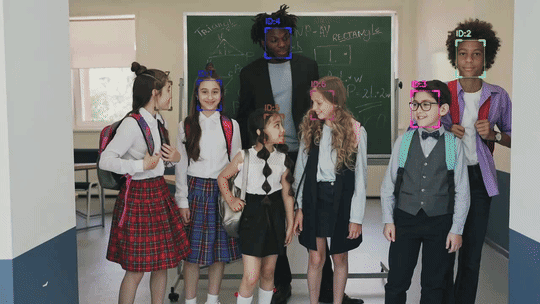

# ByteTrack: Multi-Object Tracking by Associating Every Detection Box

A clean implementation of ByteTrack for multi-object tracking using Kalman filtering and two-stage association.

<div align="center">
  
</div>


<details>
<summary>Click to see higher quality video</summary>

<video src="https://github.com/user-attachments/assets/e650395b-d0ae-4aab-b2e1-6900cece52d5" controls width="640"></video>

</details>


## Installation

```bash
pip install -r requirements.txt
```

## Usage

```python
import numpy as np
from bytetrack import BYTETracker

tracker = BYTETracker(track_thresh=0.5, track_buffer=30, match_thresh=0.8, low_thresh=0.1)

# detections: numpy array of shape (N, 5) -> [x1, y1, x2, y2, score]
detections = np.array([[100, 100, 200, 200, 0.9], [300, 300, 400, 400, 0.8]])

# tracks: numpy array of shape (M, 5) -> [x1, y1, x2, y2, track_id]
tracks = tracker.update(detections)
```

## Demo

Face tracking demo using [UniFace](https://github.com/yakhyo/uniface) for detection:

```bash
python demo.py --source 0  # webcam
python demo.py --source video.mp4 --save output.mp4
```

## References

- **ByteTrack**: [ifzhang/ByteTrack](https://github.com/ifzhang/ByteTrack) - Original implementation
- **UniFace**: [yakhyo/uniface](https://github.com/yakhyo/uniface) - Face detection library
